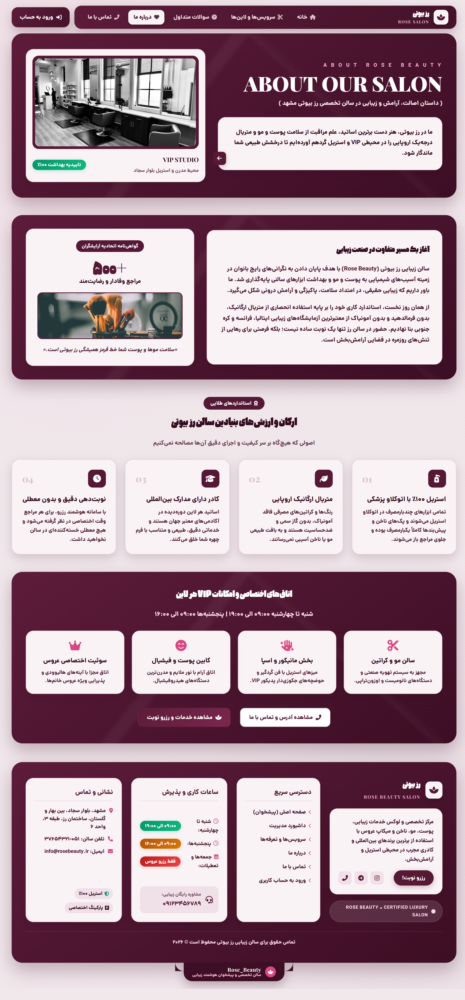
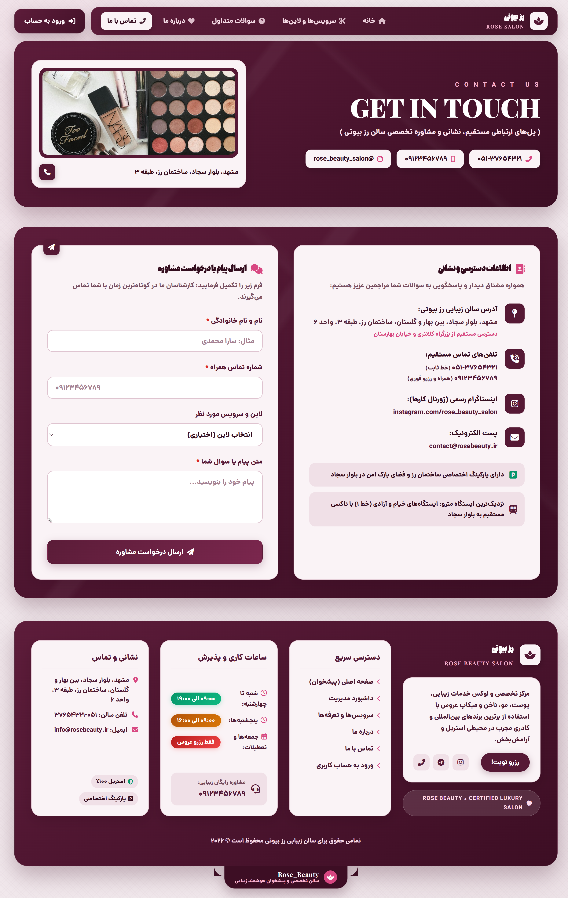
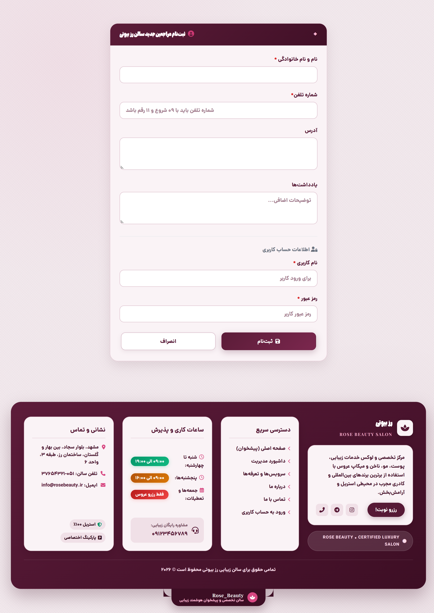
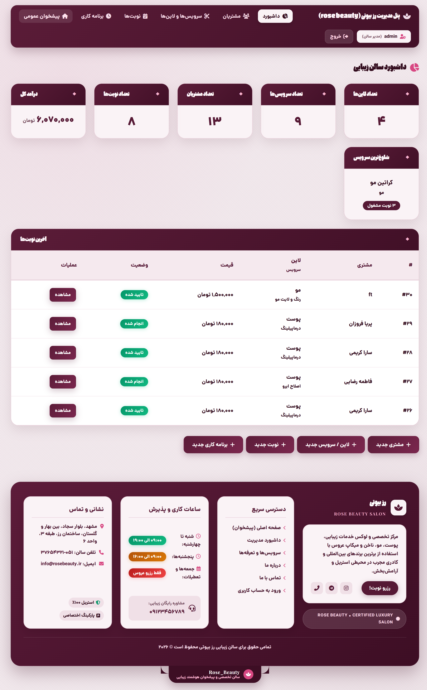
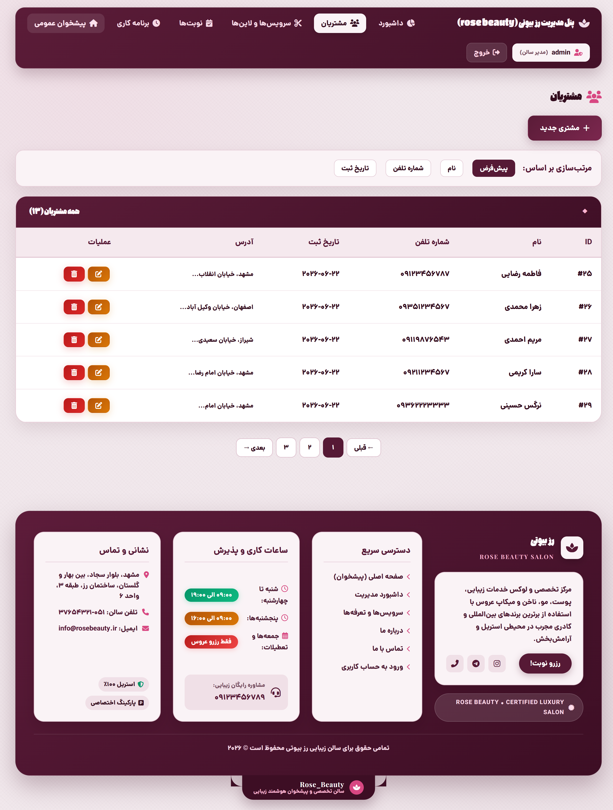
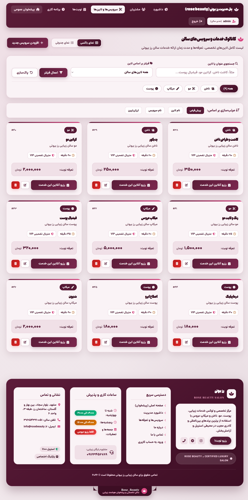
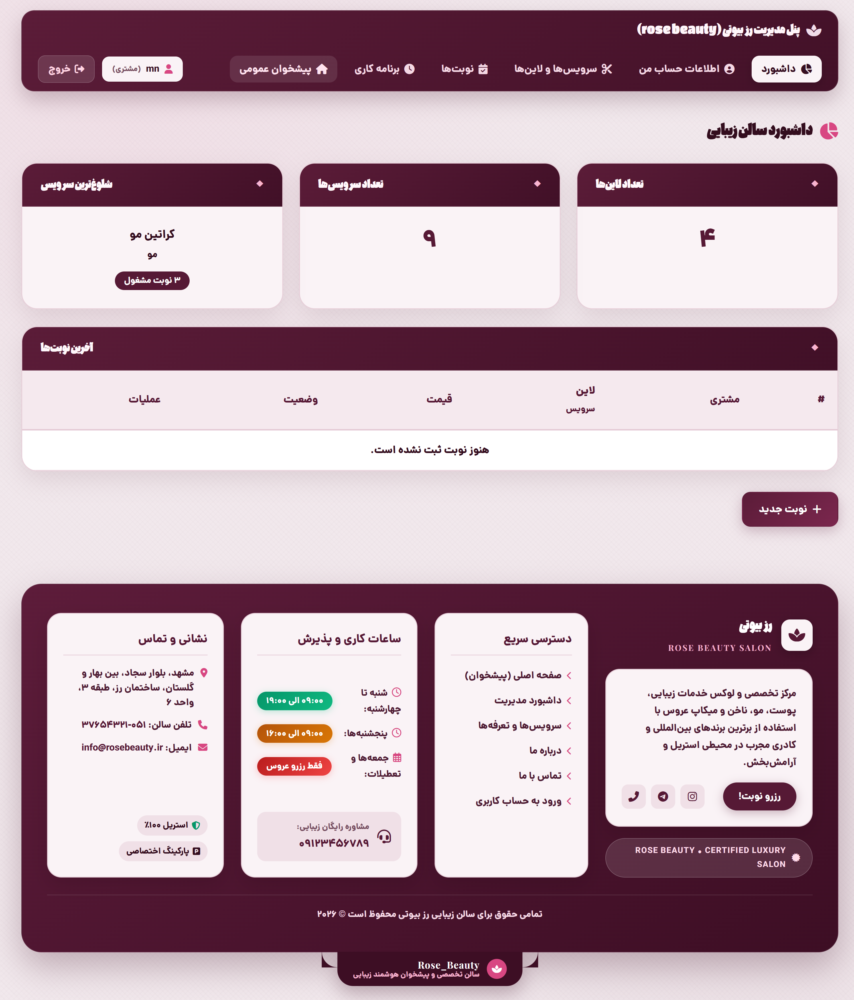

# 💇‍♀️ سیستم مدیریت سالن زیبایی رز بیوتی (Rose Beauty Salon Management System)

یک سامانه جامع و مدرن تحت وب جهت مدیریت سالن‌های زیبایی، نوبت‌دهی آنلاین مشتریان، زمان‌بندی ساعات کاری پرسنل و خطوط خدماتی، با معماری مجزا (Decoupled) توسعه‌داده‌شده با **Vue 3** در فرانت‌اند، **FastAPI (Python)** در بک‌اند، پایگاه داده **SQLite** و قابلیت استقرار کانتینری با **Docker** روی پلتفرم ابری **Render**.

---

> [!TIP]
> ### 🌐 مشاهده نسخه آنلاین (Live Demo)
> شما می‌توانید این پروژه را به صورت لایو و آنلاین در آدرس زیر مشاهده نمایید:  
> 👉 **[https://beauty-saloon-8tep.onrender.com](https://beauty-saloon-8tep.onrender.com)**  
> 
> ⚠️ **نکته مهم:** به دلیل میزبانی سرور در خارج از کشور، برای مشاهده سایت حتماً **VPN / فیلترشکن** خود را فعال کنید. همچنین با توجه به استفاده از پلن ابری رایگان، در صورتی که سرور در حالت خواب (Sleep) باشد، بارگذاری اولیه ممکن است حدود **۳۰ الی ۴۰ ثانیه** زمان ببرد.

---

## 📸 تصاویر محیط نرم‌افزار

### 🌐 صفحات عمومی، ورود و ثبت‌نام

<div align="center">

| پیشخوان همگانی و صفحه اول (Landing Page) | صفحه درباره ما (About Us) |
|:---:|:---:|
|  |  |

| صفحه تماس با ما (Contact Us) | صفحه ورود و فرم‌های سامانه (Login & Forms) |
|:---:|:---:|
|  |  |

| فرم ثبت‌نام مراجع جدید (Register) |
|:---:|
|  |

</div>

### 🛡️ پنل مدیریت سالن (Admin Panel)

<div align="center">

| داشبورد مدیریت (Admin Dashboard) | مدیریت مشتریان (Customers) |
|:---:|:---:|
|  |  |

| کاتالوگ سرویس‌ها و لاین‌ها (Services & Lines) | مدیریت نوبت‌ها و رزروها (Reservations) |
|:---:|:---:|
|  |  |

| تقویم و برنامه کاری هفتگی (Work Schedules) |
|:---:|
|  |

</div>

### 👤 پنل اختصاصی مشتریان (User Panel)

<div align="center">

| داشبورد مشتری (User Dashboard) | اطلاعات حساب کاربری (User Account) |
|:---:|:---:|
|  |  |

| نوبت‌ها و رزروهای من (User Reservations) |
|:---:|
|  |

</div>

---

## ✨ قابلیت‌های کلیدی

### 🔐 ۱. سیستم احراز هویت دوسطحی و مدیریت نقش‌ها (Role-based Auth)
- سیستم احراز هویت ایمن مبتنی بر سشن و کوکی با رمزنگاری گذرواژه‌ها (`SHA-256`)
- تفکیک کامل دسترسی‌ها در دو سطح **مدیر سالن (Admin)** و **مشتری (Customer / User)**
- گارد ناوبری فرانت‌اند (Vue Router Navigation Guards) جهت جلوگیری از دسترسی کاربران عادی به بخش‌های مدیریتی
- امکان ثبت‌نام مستقیم مشتریان جدید از طریق فرم عمومی

### 💇 ۲. مدیریت خدمات و لاین‌های سالن (Lines & Services)
- دسته‌بندی لاین‌های سالن (ناخن، مو، پوست، میکاپ، ابرو و مژه و پکیج VIP)
- تعریف خدمات متنوع به همراه تعیین مدت زمان دقیق به دقیقه (`duration_minutes`) و هزینه هر خدمت (`price`)
- نمای باکسی مدرن و کاتالوگ خدمات با امکان سوئیچ به نمای جدولی، ایجاد، ویرایش و حذف

### 🕒 ۳. تقویم هفتگی و زمان‌بندی کاری (Work Schedules)
- جدول تقویم هفتگی (شنبه تا جمعه) به تفکیک هر لاین تخصصی همراه با فیلتر لاین‌ها و آمار خلاصه اسلات‌ها
- تفکیک بصری دقیق اسلات‌های آزاد (**سبز**) و رزروشده (**قرمز**) با جلوگیری از تداخل نوبت‌ها

### 📅 ۴. سیستم نوبت‌دهی و مدیریت رزروها (Reservations)
- امکان انتخاب لاین، خدمات مورد نظر و اسلات زمانی آزاد توسط مشتری
- ثبت، لغو یا تایید نوبت‌ها با محاسبه خودکار هزینه کل و تغییر آنی وضعیت اسلات کاری به حالت `busy`
- ثبت یادداشت و ملاحظات اختصاصی مشتریان برای هر نوبت

### 📊 ۵. داشبورد آماری تمام‌عرض و ابزارهای جستجو و فیلتر
- چیدمان تمام‌عرض (Full-Width) برای صفحات داشبورد، مشتریان، سرویس‌ها، نوبت‌ها و برنامه کاری به همراه منوی وسط‌چین در هدر پنل مدیریت
- نمایش خلاصه وضعیت، تعداد کل مشتریان، خدمات فعال، درآمد و نوبت‌های ثبت‌شده
- قابلیت جستجوی پیشرفته متنی و فیلتر بر اساس وضعیت و مرتب‌سازی صعودی/نزولی

### 🎨 ۶. رابط کاربری ادیتوریال صورتی و تایپوگرافی فارسی کولاک و دانا
- طراحی ادیتوریال یکپارچه در تمام صفحات با پس‌زمینه بافت کتان صورتی، بلوک‌های رز مخملی عمیق (`#561935` تا `#3d0e24`)، شیپ‌های مستطیلی برش‌خورده و کارت‌های کرم-صورتی هم‌پوشاننده
- استفاده از تصاویر واقعی مرتبط با سالن زیبایی و لاین‌های آن (مو، ناخن، پوست، میکاپ عروس، فضای سالن)
- تایپوگرافی اختصاصی و محلی با فونت فارسی **کولاک (`ColakFAnum`)** برای تیترها و برندینگ، فونت **دانا (`DanaFaNum` در اوزان `ExtraBold` و `Black`)** برای متون و جداول، و فونت **Playfair Display** برای عناوین ادیتوریال انگلیسی
- واکنش‌گرا و کاملاً بهینه‌شده برای نمایش در موبایل و دسکتاپ

### 🌐 ۷. پیشخوان همگانی و صفحات مجزای درباره ما و تماس با ما
- هدر مشترک و یکپارچه (`PublicHeader.vue`) در صفحات خانه (`/`)، درباره ما (`/about`) و تماس با ما (`/contact`) شامل دسترسی به خانه، سرویس‌ها، سوالات متداول، درباره ما، تماس با ما و دکمه ورود
- بخش‌های معرفی خدمات، پودیوم‌های نمایشی لاین‌ها، استانداردهای سالن، پورتال‌های ورود، بخش «چرا رز بیوتی؟»، نظرات و رضایت مراجعین و سوالات متداول تعاملی (`FAQ`) در صفحه اول
- صفحات تمام‌صفحه و مجزا برای **درباره ما** و **تماس با ما** (نشانی، تلفن‌های مستقیم، راهنمای پارکینگ و مترو، و فرم ارسال پیام مشاوره)

### 🏷️ ۸. سیستم رنگ‌بندی استاندارد وضعیت‌ها و فوتر برش‌خورده سراسری
- تفکیک بصری دقیق وضعیت نوبت‌ها و ساعات کاری: **سبز** (تایید شده / انجام شده / آزاد)، **قرمز** (لغو شده / مشغول)، **خردلی** (در انتظار بررسی / رزرو شده)
- فوتر ادیتوریال یکپارچه (`Footer.vue`) در کلیه صفحات حاوی ساعات کاری شیفت‌ها، راه‌های ارتباطی و شبکه‌های اجتماعی سالن

### 🔔 ۹. سیستم اعلان‌ها و دیالوگ تایید مدرن (Toast & Confirm Modals)
- جایگزینی کامل پیام‌های سنتی مرورگر (`alert` و `confirm`) با سیستم اعلان‌ها و مودال تایید هماهنگ با پالت رز مخملی همراه با میانبر `Esc` و `Enter`
- عناوین داینامیک در تب مرورگر برای هر صفحه (`Dynamic Page Titles`) و صفحه اختصاصی ۴۰۴ (`NotFound.vue`)

---

## 🛠 تکنولوژی‌های مورداستفاده

### بخش بک‌اند (Backend)
- **زبان و فریم‌ورک:** Python 3.11+ با **FastAPI**
- **وب‌سرور ناهمگام (ASGI):** **Uvicorn**
- **پایگاه داده و ORM:** **SQLite** به همراه **SQLAlchemy**
- **مدیریت سشن و امنیت:** `starlette.middleware.sessions` و `itsdangerous`
- **مستندسازی خودکار API:** OpenAPI (Swagger UI) و ReDoc

### بخش فرانت‌اند (Frontend)
- **فریم‌ورک:** **Vue 3**
- **ابزار بیلد:** **Vite 5**
- **مسیریابی (Routing):** **Vue Router 4** در حالت SPA (HTML5 History Mode)
- **تایپوگرافی و آیکون‌ها:** فونت‌های محلی `ColakFAnum` و `DanaFaNum` (`ExtraBold` & `Black`)، فونت `Playfair Display` و Font Awesome 6

### کانتینرسازی و استقرار (DevOps)
- **کانتینرسازی:** Docker (معماری چندمرحله‌ای Multi-stage جهت بیلد فرانت با `node:20-alpine` و اجرای بک‌اند با `python:3.11-slim`)
- **هاستینگ ابری:** پلتفرم Render (منطقه فرانکفورت آلمان)

---

## 📁 ساختار پروژه

```text
beauty-saloon-manager/
│
├── backend/                        # کدهای سمت سرور (FastAPI)
│   ├── app/
│   │   ├── api/                    # روترها و اندپوینت‌های API
│   │   │   ├── auth_api.py         # احراز هویت و لاگین/لاگ‌اوت
│   │   │   ├── customers_api.py    # مدیریت مشتریان
│   │   │   ├── dashboard_api.py    # آمار و ارقام داشبورد
│   │   │   ├── deps.py             # وابستگی‌ها و احراز هویت
│   │   │   ├── lines_api.py        # مدیریت خدمات و لاین‌ها
│   │   │   ├── reservations_api.py # مدیریت رزروها و نوبت‌ها
│   │   │   └── workschedules_api.py# زمان‌بندی ساعات کاری
│   │   ├── models/                 # مدل‌های پایگاه داده SQLAlchemy
│   │   ├── schemas/                # شِماهای اعتبارسنجی داده (Pydantic)
│   │   ├── static/                 # فایل‌های استاتیک کمکی
│   │   ├── database.py             # اتصال دیتابیس و مدیریت Session
│   │   └── main.py                 # نقطه ورود اصلی سرور و سرو کننده SPA و دارایی‌ها
│   ├── saloon.db                   # پایگاه داده SQLite حاوی داده‌های آماده
│   ├── requirements.txt            # لیست پکیج‌های پایتون
│   └── seedtest.py                 # اسکریپت تزریق داده‌های اولیه نمونه
│
├── frontend/                       # کدهای سمت کاربر (Vue 3 + Vite)
│   ├── public/                     # دارایی‌های استاتیک کپی‌شونده در بیلد
│   │   ├── fonts/                  # فونت‌های کولاک و دانا (ColakFAnum, DanaFaNum)
│   │   └── images/                 # تصاویر واقعی لاین‌ها و محیط سالن زیبایی
│   ├── src/
│   │   ├── components/             # کامپوننت‌های مشترک
│   │   │   ├── PublicHeader.vue    # هدر کپسولی مشترک صفحات خانه، درباره ما و تماس با ما
│   │   │   ├── Footer.vue          # فوتر سراسری ادیتوریال پروژه
│   │   │   ├── ToastContainer.vue  # ظرف اعلان‌های شناور سراسری
│   │   │   └── ConfirmModal.vue    # مودال تایید عملیات‌های حساس
│   │   ├── services/               # سرویس‌های کمکی و استیت نوتیفیکیشن
│   │   │   ├── toast.js            # مدیریت اعلان‌های شناور
│   │   │   └── confirm.js          # مدیریت پرامیس مودال‌های تایید
│   │   ├── views/                  # صفحات و نماهای کاربری
│   │   │   ├── Landing.vue         # پیشخوان همگانی و صفحه اول سالن
│   │   │   ├── About.vue           # صفحه اختصاصی درباره ما
│   │   │   ├── Contact.vue         # صفحه اختصاصی تماس با ما و مشاوره
│   │   │   ├── NotFound.vue        # صفحه اختصاصی ۴۰۴
│   │   │   ├── CustomerForm.vue    # ثبت‌نام و فرم مشتری
│   │   │   ├── Customers.vue       # لیست مشتریان
│   │   │   ├── Dashboard.vue       # داشبورد مدیریت و آمار سالن
│   │   │   ├── LineForm.vue        # فرم افزودن/ویرایش لاین
│   │   │   ├── Lines.vue           # کاتالوگ خدمات (باکسی و جدولی)
│   │   │   ├── Login.vue           # صفحه ورود
│   │   │   ├── ReservationDetail.vue # جزئیات رزرو
│   │   │   ├── ReservationForm.vue # ثبت رزرو جدید
│   │   │   ├── Reservations.vue    # لیست رزروها
│   │   │   ├── ScheduleForm.vue    # فرم ساعات کاری
│   │   │   └── Schedules.vue       # تقویم هفتگی و ساعات کاری هر لاین
│   │   ├── api.js                  # لایه ارتباط با اندپوینت‌های بک‌اند
│   │   ├── auth.js                 # مدیریت استیت احراز هویت
│   │   ├── router.js               # تنظیمات مسیرها، گارد احراز هویت و عناوین داینامیک
│   │   ├── style.css               # سیستم طراحی ادیتوریال صورتی، فونت‌های دانا و کولاک
│   │   └── App.vue                 # کامپوننت ریشه برنامه و هدر مدیریت
│   ├── index.html                  # قالب اصلی صفحه
│   ├── vite.config.js              # پیکربندی Vite و پروکسی دولوپمنت
│   └── package.json                # مشخصات و وابستگی‌های فرانت‌اند
│
├── screenshots/                    # اسکرین‌شات‌های به‌روز مستندسازی پروژه
├── Dockerfile                      # داکرفایل چندمرحله‌ای برای بیلد و ران
├── render.yaml                     # پیکربندی سرویس ابری Render
├── start.py                        # اسکریپت اجرای همزمان لوکال (ویندوز)
├── .dockerignore
├── .gitignore
└── readme.md
```

---

## 🚀 راهنمای نصب و راه‌اندازی لوکال (محلی)

### ۱. پیش‌نیازها
- **Python 3.10+**
- **Node.js 18+** و **npm**

---

### ۲. کلون و آماده‌سازی مخزن

```bash
git clone https://github.com/mhdds-codesign/beauty_saloon.git
cd beauty_saloon
```

---

### ۳. روش اول: اجرای سریع و خودکار (با start.py)

در محیط ویندوز می‌توانید تنها با اجرای اسکریپت `start.py`، هم فرانت‌اند و هم بک‌اند را با یک دستور بالا بیاورید:

```powershell
# ۱. ساخت و فعال‌سازی محیط مجازی پایتون
python -m venv .venv
.\.venv\Scripts\Activate.ps1

# ۲. نصب وابستگی‌های بک‌اند
pip install -r backend\requirements.txt

# ۳. نصب وابستگی‌های فرانت‌اند
cd frontend
npm install
cd ..

# ۴. اجرای همزمان هر دو بخش
python start.py
```

- برنامه فرانت‌اند در آدرس: `http://localhost:5173`
- سرور بک‌اند در آدرس: `http://127.0.0.1:8000`
- مستندات تعاملی Swagger در آدرس: `http://127.0.0.1:8000/docs`

---

### ۴. روش دوم: اجرای دستی و مجزا

#### اجرای بک‌اند (FastAPI):
```powershell
cd backend
..\.venv\Scripts\uvicorn app.main:app --reload --host 127.0.0.1 --port 8000
```

#### اجرای فرانت‌اند (Vite Dev Server):
```powershell
cd frontend
npm run dev
```

---

### ۵. روش سوم: اجرا با داکر (Docker)

```bash
docker build -t beauty-saloon .
docker run -p 8000:8000 beauty-saloon
```
پس از اجرا، کل برنامه (فرانت و بک) در پورت `http://localhost:8000` در دسترس خواهد بود.

---

## 👤 حساب‌های کاربری پیش‌فرض جهت تست

برای بررسی سریع امکانات سامانه (هم در نسخه لوکال و هم در نسخه آنلاین)، می‌توانید از حساب کاربری زیر استفاده کنید:

| نام کاربری (Username) | رمز عبور (Password) | نقش (Role) | توضیحات |
|:---:|:---:|:---:|:---:|
| `admin` | `admin123` | **مدیر ارشد (Admin)** | دسترسی کامل به کلیه بخش‌ها، مدیریت نوبت‌ها، تغییر وضعیت، تعریف لاین و زمان‌بندی |

> [!NOTE]
> کاربران عادی می‌توانند مستقیماً از طریق لینک **ثبت‌نام** در صفحه ورود، حساب جدید ایجاد کرده و اقدام به رزرو نوبت نمایند.

---

## 📄 لایسنس و حقوق استفاده

این پروژه به منظور اهداف آموزشی و نمونه‌کار طراحی و توسعه داده شده است. استفاده و توسعه آن با ذکر منبع بلامانع است.
